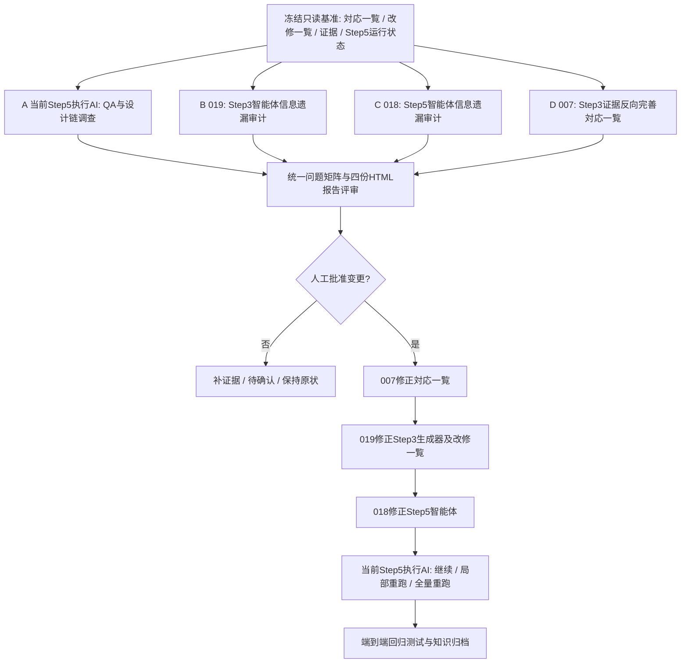

# Step5／007／019／018 并行调查与整改执行流程

> 版本 v2.0｜2026-11-15｜流程模板；实际工程执行状态全部待确认  
> **角色：**007＝対応一覧开发；019＝Step3智能体开发；018＝Step5智能体开发；**当前Step5执行AI**＝正在执行Step5的实例（与018不同）。  
> **核心变更：四条调查并行启动；统一评审后，按依赖顺序批准修复。** 不假设公司使用Git；公司证据与机密只保存在授权工程目录，不上传公共仓库。

## 一、流程总图



**并行边界：**四条轨道只读、各自独立报告目录和日志；允许共享同一冻结输入，不允许相互改写或覆盖正在运行的Step5输入。先记录输入版本/哈希/时间戳；如果无法冻结，只能记录读取时基准和变动风险。任何修复都必须另行审批。

## 二、阶段安排

| 阶段 | 任务 | 负责人 | 输入 | 输出/完成门禁 | 状态 |
|---|---|---|---|---|---|
| 0 | 确定只读基准、目录与任务隔离 | 协调者/各AI | 対応一覧、改修一覧、Step3证据、Step5日志、Agent实现 | 版本清单、可访问范围、独立输出目录 | 待确认 |
| 1A（并行） | 当前Step5 QA和设计完整性调查 | 当前Step5执行AI | 改修一覧、运行日志、设计成果 | HTML-A、QA台账、改修→设计覆盖矩阵 | 未开始 |
| 1B（并行） | Step3智能体遗漏审计 | 019 | 対応一覧、Step3实现、改修一覧、证据 | HTML-B、対応→改修覆盖矩阵、生成器修正案 | 未开始 |
| 1C（并行） | Step5智能体遗漏审计 | 018 | 改修一覧、Step5实现、运行成果 | HTML-C、改修→设计覆盖矩阵、智能体修正案 | 未开始 |
| 1D（并行） | Step3证据反向完善対応一覧 | 007 | Step3全部证据、現行対応一覧 | HTML-D、候选补充项与前后差分 | 未开始 |
| 2 | 合并问题、去重、根因裁决、P0/P1/P2与审批 | 用户＋各AI | 四份HTML和证据矩阵 | 统一问题表、获批差分、实施顺序 | 未开始 |
| 3 | 007正式修复 | 007 | 已批准差分 | 対応一覧新基准、变更证据、审批记录 | 未开始 |
| 4 | 019正式修复 | 019 | 007新基准及已批准修复 | Step3生成器修复、改修一覧新基准、回归证据 | 未开始 |
| 5 | 018正式修复 | 018 | 改修一覧新基准及已批准修复 | Step5智能体修复、回归证据 | 未开始 |
| 6 | 当前Step5成果恢复和验证 | 当前Step5执行AI | 已验证的新输入与018版本 | 继续/局部/全部重跑决策及设计成果 | 未开始 |
| 7 | 全链路回归与归档 | 各AI＋用户 | 所有修复与证据 | 覆盖矩阵、PASS/BLOCKED/NOT_VERIFIED、知识归档 | 未开始 |

> 阶段3→6是默认依赖顺序。P0可经审批先做最小补救；不要求等待全部P2改善，但必须记录临时修复与永久修复的差异。018修复不能自动改变正在运行的Step5实例；须核实部署/加载版本和影响。

## 三、四条并行调查：直接复制的中日双语提示词

### A｜当前 Step5 执行 AI

**调查目标：**当前运行 Step5 的 QA、用户需求及基本/详细设计完整性。

**中文提示词**

```text
你是当前实际执行 Step5 的 AI，不是018（018负责开发Step5智能体）。请在授权环境对当前Step5的真实输入版本、执行日志、QA、子Agent返回、用户需求、基本设计、详细设计做只读全量审查。逐项追溯改修ID→用户需求→基本设计→详细设计，识别遗漏、错误转译、未经证实的假设、未解决QA及下游影响；必要时向上追溯対応ID。每个问题记录问题ID、原文/证据文件路径和行号、输入版本或哈希、实际现象、根因候选、影响、最小修复建议、是否需要局部/全量重跑、复验办法。生成完整独立HTML报告（中文正文＋日文版）、问题台账和覆盖矩阵，写入授权项目document/或output/下独立任务目录。禁止修改正式清单、设计、运行状态或重启Step5；不将真实业务决策QA擅自回答。先交报告等待审批。
```

**日本語プロンプト**

```text
あなたは現在Step5を実行しているAIです。Step5エージェント開発担当の018とは別です。許可された環境で現行Step5の入力版、実行ログ、QA、サブAgent応答、ユーザー要求、基本設計、詳細設計を読み取り専用で全件調査してください。改修ID→ユーザー要求→基本設計→詳細設計を項目単位で追跡し、欠落、誤変換、未検証の仮定、未解決QA、下流影響を特定してください。必要に応じ対応IDまで遡ってください。各問題についてID、原文・証拠パスと行番号、入力版またはハッシュ、事象、根本原因候補、影響、最小修正案、部分/全件再実行の要否、再検証方法を記録してください。中国語本文と日本語版を含む独立HTML報告書、課題台帳、網羅性マトリクスを許可されたプロジェクトのdocument/またはoutput/内の専用領域に作成してください。正式一覧・設計・実行状態の変更やStep5再起動は禁止します。業務判断が必要なQAを独断で解決しないでください。報告後、承認を待ってください。
```

### B｜019 AI（Step3 智能体开发）

**调查目标：**对应一览→Step3智能体→改修一览的信息保全及永久修复。

**中文提示词**

```text
你是019，负责Step3智能体开发。请只读审查真实Step3智能体实现（提示词、规则、脚本、子Agent调用、输入解析、对象分类、影响展开、输出模板、校验及错误处理），对照007対応一覧的冻结基准与现有Step3改修一覧和全部证据文件。逐项建立対応ID→改修ID及反向覆盖矩阵，检测遗漏、合并丢细节、错误分类、无证据扩展、重复、字段截断、版本错配和异常静默跳过。区分①对应一览原本缺项②Step3读取/理解丢失③生成/校验丢失④真实业务未决。对每个缺陷提供精确修正位置（文件/规则/函数/提示词）、修改前后建议、回归用例、当前改修一覧补救办法、对运行中Step5的影响和重跑建议。生成完整独立中日双语HTML审查报告、覆盖矩阵和缺陷清单。仅提出方案，不直接修改生成器或当前改修一覧，未经批准不得触碰正在被Step5读取的文件。
```

**日本語プロンプト**

```text
あなたはStep3エージェント開発担当019です。実際のStep3実装（プロンプト、規則、スクリプト、サブAgent呼出し、入力解析、分類、影響展開、出力様式、検証、例外処理）を読み取り専用で監査し、007対応一覧の固定基準と現行Step3改修一覧および全証拠ファイルを照合してください。対応ID→改修IDと逆方向の網羅性マトリクスを作成し、欠落、統合による詳細消失、誤分類、根拠のない追加、重複、項目切捨て、版不一致、エラーの黙殺を検出してください。①対応一覧の元々の欠落②Step3読込・理解での欠落③生成・検証での欠落④業務上の未決事項を区別してください。欠陥ごとに正確な修正箇所（ファイル・規則・関数・プロンプト）、修正前後案、回帰テスト、現行改修一覧の救済策、実行中Step5への影響と再実行案を示してください。独立した日中両言語の完全HTML監査報告、網羅性マトリクス、欠陥一覧を作成してください。承認前の生成器・改修一覧変更およびStep5使用中ファイルへの操作は禁止します。
```

### C｜018 AI（Step5 智能体开发）

**调查目标：**改修一览→Step5智能体→用户需求/基本设计/详细设计的信息保全。

**中文提示词**

```text
你是018，负责Step5智能体开发，不是当前Step5执行AI。请只读审查真实Step5智能体实现：改修一覧读取、字段映射、分组/合并、子Agent上下文传递、QA处理、用户需求生成、基本设计生成、详细设计生成、检查和保存逻辑。以现有改修一覧冻结版本为基准，对照当前Step5日志、子Agent输出及已有成果，建立改修ID→用户需求ID→基本设计位置→详细设计位置双向覆盖矩阵。识别漏读、截断、错误理解、上下文丢失、证据未传递、QA未经根因分析直接上抛、设计不一致及未验证即标记完成。区分源输入缺陷与018智能体缺陷，逐项给出证据、根因、修正文件/提示词/函数、修改前后建议、测试用例、对当前Step5成果的补救和局部/全量重跑建议。生成完整独立中日双语HTML报告、缺陷台账和覆盖矩阵；不得未经批准修改智能体、设计成果或干扰当前运行。
```

**日本語プロンプト**

```text
あなたはStep5エージェント開発担当018であり、現在のStep5実行AIとは別です。実際のStep5エージェント実装について、改修一覧の読込、項目対応、グルーピング・統合、サブAgentへの文脈引渡し、QA処理、ユーザー要求・基本設計・詳細設計の生成、検証、保存を読み取り専用で監査してください。現行改修一覧の固定版を基準にStep5ログ、サブAgent出力、既存成果物を照合し、改修ID→要求ID→基本設計箇所→詳細設計箇所の双方向網羅性マトリクスを作成してください。読込漏れ、切捨て、誤解、文脈喪失、証拠引渡し漏れ、根本原因分析なしのQA丸投げ、設計不整合、未検証の完了扱いを検出してください。入力側欠陥と018エージェント側欠陥を区別し、証拠、原因、修正対象ファイル・プロンプト・関数、変更前後案、試験、現行成果の救済、部分/全件再実行案を示してください。独立した日中両言語の完全HTML報告、欠陥台帳、網羅性マトリクスを作成してください。承認前のエージェント・設計変更や実行中処理への干渉は禁止します。
```

### D｜007 AI（对应一览开发）

**调查目标：**利用Step3证据文件反向发现对应一览可补充的信息。

**中文提示词**

```text
你是007，负责対応一覧开发。请只读调查当前Step3输出的所有证据文件、影响调查明细、设计书定位、源码引用、DB/外部API/IF/画面/画面关联CSV/OL/BT的对象与关系，并逐项反向对照现有対応一覧的対応ID、名称、概要説明、改修内容。找出①已有項目但描述不完整②缺失改修对象/关联③证据与対応一覧冲突④仅为实现细节不应进入业务范围清单⑤可能扩大业务范围、需人工批准的候选。逐条标注证据路径/行号、来源版本/哈希、关联対応ID、原文、拟补充内容、修改前后差分、补充理由、风险、是否需要019重新生成。保持对应一览简洁，不把所有程序/证据细节原样堆入主体，可用附属证据索引。生成完整独立中日双语HTML反向完善建议报告及候选差分清单；只调查和提案，不直接修改正式対応一覧，也不能把Step3推断自动视为业务事实。
```

**日本語プロンプト**

```text
あなたは対応一覧開発担当007です。現行Step3が出力したすべての証拠ファイル、影響調査詳細、設計書位置、ソース参照、DB/外部API/IF/画面/画面関連CSV/OL/BTの対象と関連を読み取り専用で調査し、既存対応一覧の対応ID・名称・概要説明・改修内容と逆方向に照合してください。①既存項目の記述不足②対象・関連の欠落③証拠との矛盾④実装詳細であり業務スコープ一覧に入れるべきでない内容⑤業務範囲拡大の可能性があり承認が必要な候補を区別してください。証拠パス・行番号、元版・ハッシュ、対応ID、原文、補足案、変更前後差分、理由、リスク、019再生成要否を記録してください。対応一覧本体は簡潔に維持し、詳細は別紙の証拠索引で管理してください。独立した日中両言語の完全HTML改善提案報告書と差分候補一覧を作成してください。正式対応一覧は変更せず、Step3の推測を業務事実と見なさないでください。
```

## 四、四份报告统一交付格式

每份独立HTML报告必须包含：①任务身份/范围/输入基准；②调查方法与实际覆盖范围、未检查项；③逐条发现与证据定位；④双向追踪矩阵（适用时）；⑤根因分类及置信/未确认项；⑥具体修改位置与修改前后建议；⑦当前工程紧急补救 vs 智能体永久修复；⑧风险、依赖、P0/P1/P2；⑨验证用例与PASS条件；⑩需人工审批的事项。**中文完整内容在前，日文完整内容在后**，禁止只翻译标题或写无证据结论。

统一问题记录字段：`问题ID｜发现轨道｜对应ID｜改修ID｜实际现象｜证据路径:行号｜输入版本/哈希｜根因类别｜责任AI｜007修正｜019修正｜018修正｜当前Step5补救｜优先级｜审批｜复验｜状态`。

**跨报告对账：**019发现対応一覧本身缺项时通知007纳入候选；007发现Step3证据暴露生成器遗漏时通知019；018发现改修一覧缺项时通知019；当前Step5执行AI发现设计链缺失时通知018。各方保留原始发现，不在未批准前互相改写成果。

## 五、后续阶段提示词（中日双语）

### 2｜统一评审（交给协调AI/各负责人）
**中文**
```text
请汇总四条并行调查的HTML-A/B/C/D及原始证据，按对应ID/改修ID去重并保留发现来源。逐项裁定“007对应一览缺项／019 Step3智能体丢失／018 Step5智能体丢失／当前Step5执行问题／业务待确认”，不能无证据归责。输出统一问题矩阵、P0/P1/P2、007→019→018→当前Step5的依赖顺序、当前工程临时补救与永久修复区别、审批清单和复验方案。所有正式修改待用户明确批准。
```
**日本語**
```text
4系統のHTML-A/B/C/Dと原証拠を統合し、対応ID・改修IDで重複排除しつつ発見元を保持してください。007対応一覧の不足、019 Step3エージェントの欠落、018 Step5エージェントの欠落、現行Step5実行上の問題、業務判断待ちを証拠に基づき分類してください。統合課題表、P0/P1/P2、007→019→018→現行Step5の依存順序、暫定救済と恒久対策の区別、承認一覧、再検証計画を作成してください。正式変更は利用者の明示承認後に限定します。
```

### 3｜007 修复対応一覧
**中文**
```text
你是007。只实施第二阶段获批准的対応一覧差分。以原始设计和源码证据核验Step3证据文件反向发现的候选项，区分业务范围与实现细节，保持主体简洁，详细证据进入附属索引。备份旧版、保留对应ID映射、记录修改前后及审批，生成新冻结基准交019。不得未经批准扩大业务范围或覆盖Step5正在读取的文件。输出实施和复验报告。
```
**日本語**
```text
あなたは007です。第2段階で承認された対応一覧差分のみ実施してください。Step3証拠ファイルから逆引きした候補を原設計書・ソースの証拠で検証し、業務範囲と実装詳細を分け、本体は簡潔に、詳細証拠は別索引へ保存してください。旧版保全、対応ID対応付け、変更前後と承認を記録し、新しい固定基準を019に引き渡してください。未承認の範囲拡大と実行中Step5参照ファイルの上書きを禁止します。実施・検証報告を提出してください。
```

### 4｜019 修复Step3智能体与改修一覧
**中文**
```text
你是019。依据第二阶段批准的问题及007交付的新冻结基准，先修正Step3智能体中被证实的信息遗漏点（具体提示词/脚本/解析/展开/校验），以已批准测试用例回归。随后受控生成/补正改修一覧，逐项核对対応ID↔改修ID、证据、版本、重复和遗漏。旧版和差分必须保留，当前Step5读取中的文件不能直接覆盖。提交永久修复、当前改修一覧补救及复验报告给018和Step5执行AI。
```
**日本語**
```text
あなたは019です。承認済み課題と007の新固定基準に基づき、Step3エージェントの実証済み欠落箇所（プロンプト・スクリプト・解析・展開・検証）を修正し、承認済みテストで回帰検証してください。その後、改修一覧を管理下で再生成または補正し、対応ID↔改修ID、証拠、版、重複、欠落を照合してください。旧版と差分を保存し、現行Step5が参照中のファイルを直接上書きしないでください。恒久対策、現行一覧の救済、再検証結果を018とStep5実行AIに引き渡してください。
```

### 5｜018 修复Step5智能体
**中文**
```text
你是018，负责Step5智能体开发，不是当前执行AI。依据批准的缺陷和019交付的改修一覧新基准，修复已确认的读取、映射、子Agent传递、QA根因分析、用户需求/基本设计/详细设计生成及检查缺陷。逐项以改修ID→需求→基本设计→详细设计回归验证；保存旧版、差分、测试证据和部署/加载说明。不要假设修复会自动应用到当前运行实例。提交修复报告和兼容/重跑建议，待批准再部署。
```
**日本語**
```text
あなたはStep5エージェント開発担当018であり、現行実行AIとは別です。承認済み欠陥と019からの改修一覧新基準に基づき、読込、項目対応、サブAgent引渡し、QA根本原因分析、要求・基本設計・詳細設計生成と検証の実証済み欠陥を修正してください。改修ID→要求→基本設計→詳細設計を項目単位で回帰検証し、旧版、差分、テスト証拠、配備・読込手順を保存してください。修正が実行中インスタンスに自動適用されると仮定しないでください。修正報告と互換性・再実行案を提出し、承認後に配備してください。
```

### 6｜当前Step5执行AI恢复与设计复验
**中文**
```text
你是当前Step5执行AI。核对019新改修一覧及018新智能体的实际版本、是否已被当前实例加载、既有用户需求/基本设计/详细设计的有效性。基于逐项覆盖和依赖证据，提出A继续/B局部重跑/C全量重跑三选一及回退方案；先保存运行状态、日志、输入输出快照。得到批准后执行并复验；PASS须有证据，业务阻塞为BLOCKED，未验证为NOT_VERIFIED。生成中日双语结果HTML报告，不擅自中断运行。
```
**日本語**
```text
あなたは現行Step5実行AIです。019の新改修一覧と018の新エージェントの実際の版、現行インスタンスへの読込有無、既存要求・基本設計・詳細設計の有効性を確認してください。項目単位の網羅性と依存証拠に基づきA継続/B部分再実行/C全件再実行の一つを選び、復旧案を提示してください。実行状態・ログ・入出力スナップショットを保存し、承認後に実行・再検証してください。PASSには証拠を必須とし、業務判断待ちはBLOCKED、未検証はNOT_VERIFIEDとします。日中両言語の結果HTML報告を作成し、無断で実行を中断しないでください。
```

### 7｜全链路回归与归档
**中文**
```text
协调007、019、018和当前Step5执行AI，针对正常、遗漏、重复、错版、证据不足、QA上抛、子Agent上下文丢失等用例执行端到端回归。交付対応ID→改修ID→用户需求→基本设计→详细设计覆盖矩阵、测试证据、未决事项、版本哈希、报告索引及跨会话恢复说明。区分正式知识、候选知识、审计记录；公司资料只归档到授权项目document/或output/，公共GitHub仅保存脱敏流程模板。
```
**日本語**
```text
007、019、018、現行Step5実行AIを連携し、正常系、欠落、重複、版違い、証拠不足、QA丸投げ、サブAgentの文脈喪失などをエンドツーエンドで回帰検証してください。対応ID→改修ID→ユーザー要求→基本設計→詳細設計の網羅性マトリクス、テスト証拠、未決事項、版・ハッシュ、報告書索引、セッション再開手順を提出してください。正式知識・候補知識・監査記録を区別し、社内資料は許可されたdocument/またはoutput/に保存し、公開GitHubには機密を除いた手順テンプレートのみ置いてください。
```

## 六、当前立即执行清单

- [ ] 记录四条轨道共用的输入基准和只读范围。
- [ ] 同时向当前Step5执行AI、019、018、007分别发送第A/B/C/D条提示词。
- [ ] 分别取得HTML-A、HTML-B、HTML-C、HTML-D；任何一份未完成都不得宣称全量调查结束。
- [ ] 合并问题并审批；按依赖顺序实施修复与复验。

## 七、更新记录

| 日期 | 版本 | 内容 |
|---|---|---|
| 2026-11-15 | v2.0 | 由串行七步重构为四轨并行调查；新增018 Step5智能体审计、019 Step3信息保全审计、007证据反向完善；四份HTML报告；全部阶段中日双语提示词 |
| 2026-11-15 | v1.1 | 区分当前Step5执行AI；七步中日双语提示词 |
| 2026-11-15 | v1.0 | 初版七步流程 |

> 注意：文件名沿用原路径以保持现有链接不失效；本文件内容以v2.0为准。
